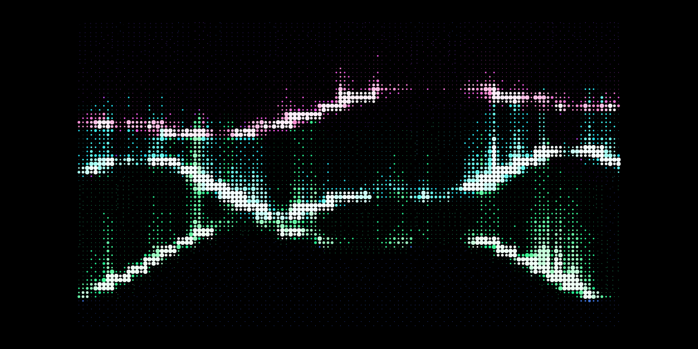

  

⠀⠀⠀⠀⠀⠀⠀⠀⠀⠀⠀⠀⠀⠀⠀⠀⠀⠀⠀⠀⠀⠀⠀⠀⠀⠀⠀⠀⠀⠀⠀⠀⠀⠀⠀⠀⠀⠀⠀
## Hey there 👋 I'm Bronzy!
**Student Developer · AI & Software Engineering**

_Turning ideas into intelligent software._
· India

🧠 About Me
I'm a student developer interested in Artificial Intelligence, software engineering, and building useful technology.
🐍 Python is my primary language.
🌐 Exploring web development with JavaScript.
🤖 Interested in AI and intelligent systems.
🐧 Linux enthusiast.
🚀 Building projects, experimenting, and learning by doing.
My philosophy: Build. Experiment. Improve.

<h3 align="center">⚡ Tech Stack</h3>

  

<h3 align="center">🤝 Connect & Collaborate</h3>

  Open to connecting with developers, exploring ideas, and building cool things together.

  

  <i>Have an interesting idea? Let's build something.</i>

<h2 align="center">📊 GitHub Statistics</h2>

  
  

<h2 align="center">🔥 Contribution Streak</h2>

  

<h2 align="center">📈 Contribution Activity</h2>

  

_Always learning. Always building._
